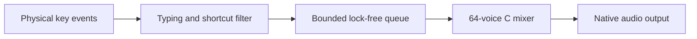

# Clack

A native macOS menu bar app that makes everyday typing sound like a mechanical keyboard. Built for personal use, with deep Holy Panda recordings, stereo positioning, and a fast audio path.

## Features

- **Deep thock:** five letter-key variations and distinct spacebar, Enter, and delete recordings.
- **Press and release:** separate sounds for both parts of a keystroke, with optional release audio.
- **Spatial sound:** stereo positioning, short timing differences, and subtle reflections.
- **Typing only:** Command/Control shortcuts, modifiers, arrows, Escape, and function keys stay quiet. Shift/Option typing works normally.
- **Menu bar controls:** pause, volume, spatial width, preview, and launch at login.
- **Local and private:** listens to physical key codes without reading text or saving keystrokes. No microphone, account, or network connection is needed.

## Install

Requires **macOS 13 or later**, a **Swift 6 toolchain**, and Apple's command line tools. Full Xcode is optional. The permission-check script also uses Python 3.

```sh
git clone git@github.com:jhaynie/clack.git
cd clack
./scripts/install.sh
```

The installer builds a release app, signs it locally, installs it at `~/Applications/Clack.app`, and opens it. Run the same command to install updates; it closes the running instance before replacing it and preserves your preferences.

To build without installing, run `./scripts/build.sh`. The bundle appears at `dist/Clack.app`.

### Allow keyboard access

Enable **Clack** in **System Settings → Privacy & Security → Input Monitoring**. Choose **Quit & Reopen** if macOS asks. Clack's status should become **Listening across your Mac**.

Input Monitoring lets Clack hear keys while you use other apps. **Preview** works independently of that permission, so it helps distinguish keyboard-access issues from audio issues.

Local builds use an existing **Apple Development** signing identity when available, keeping the signing requirement stable across updates. Otherwise, builds use ad-hoc signing, which can require fresh permission approval after rebuilding. `CLACK_SIGN_IDENTITY` overrides the selected identity.

## Use

Click the keyboard icon in the menu bar to open Clack. Right-click for quick pause or quit. Launch at login is enabled on first run and can be changed in the menu.

| Control | What it does |
| --- | --- |
| Keyboard sounds | Turn typing audio on or off |
| Volume | Adjust sound level |
| Spatial width | Move from centered sound to a wider keyboard image |
| Key release sounds | Include or omit release recordings |
| Preview | Play a short typing sequence |
| Launch at login | Start Clack when you sign in |

Letters, numbers, punctuation, space, Tab, Enter, Backspace, forward delete, and numeric keypad input make sound. Holding a key produces one physical press/release pair; OS autorepeat adds no extra clicks. Shortcuts such as **⌘Tab**, **⌘C**, **⌘V**, and **Control+A** are silent, including their releases.

Use wired headphones or local speakers for the fastest response. Bluetooth and AirPlay add output delay. The spatial effect is stereo, without head tracking.

## Troubleshooting

**Settings says enabled, but Clack still asks for permission:** a signing change can leave an old approval in place. Remove only Clack from Input Monitoring, re-add `~/Applications/Clack.app`, enable it, and reopen it. This is especially relevant when switching from ad-hoc signing to a development certificate.

Verify actual access from the installed app:

```sh
./scripts/check-input.sh
```

This attempts to create the same keyboard listener used by Clack and exits with an error if macOS denies it. It does not grant or reset permissions.

**Preview works, but typing is silent:** check Input Monitoring and the shortcut rules above. macOS Secure Input can prevent keyboard events in password fields and other protected contexts.

**No sound, including Preview:** check Clack's volume, system volume, and selected output. Use **Retry Audio** in the menu. Clack also restarts audio after output configuration changes or waking from sleep.

**Login launch needs approval:** use **Approve in Login Items…** in the menu to open the relevant system setting.

## Audio design



A dedicated input thread keeps keyboard events independent of menu rendering. Recordings are loaded before playback. An `AVAudioSourceNode` feeds the mixer directly into `AVAudioEngine`; the audio callback performs no file access, allocation, or locking.

The mixer supports overlapping keys, varies letter samples and pitch, and adds constant-power stereo positioning, short interaural delays, and subtle reflections. Volume changes are smoothed, and soft saturation protects overlapping chords. Pausing keeps the engine ready for immediate resume.

The engine requests a **128-frame output buffer** where supported and restores previous device buffer sizes on quit. At 48 kHz, 128 frames represent about **2.67 ms** of buffering. Hardware and output transport add latency beyond this buffer.

## Development checks

```sh
./scripts/test.sh        # Behavior tests with address/undefined sanitizers
./scripts/benchmark.sh   # Event enqueue and 64-voice render timings
```

Tests cover onset, stereo positioning, overlapping keys, mute/resume, release sounds, spacebar selection, overload recovery, concurrent producers, invalid samples, and typing/shortcut policy. They exercise the C mixer directly and run with command line tools alone.

The benchmark reports a sustained 64-voice workload. A development run measured roughly **0.04 µs** for event enqueue and **36 µs** for a 128-frame render at the 99th percentile. These measure mixer work; perceived delay also includes event delivery and audio hardware.

| Path | Purpose |
| --- | --- |
| `Sources/Clack/` | Native UI, keyboard listener, audio engine, and login settings |
| `Sources/ClackAudio/` | Lock-free event queue and realtime audio mixer |
| `Resources/` | App metadata, icon, recordings, and sound attribution |
| `Tests/ClackAudioTests/` | Audio behavior tests |
| `scripts/` | Build, install, diagnostics, tests, benchmark, and icon generation |

## Sound credits

Holy Panda recordings are by **Thomas Lai**, from [kbsim](https://github.com/tplai/kbsim), obtained through [Mechvibes](https://github.com/hainguyents13/mechvibes/tree/master/src/audio/holy-pandas). Their MIT license and attribution are bundled with the app and included in [Resources/SoundLicense.txt](Resources/SoundLicense.txt) and [Resources/SoundCredits.txt](Resources/SoundCredits.txt).

The original recordings were MP3. Bundled assets are mono 48 kHz float PCM WAV files to avoid decoding during playback.
